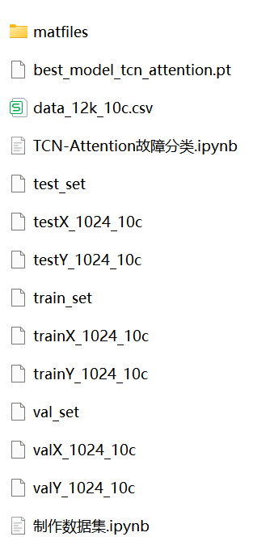
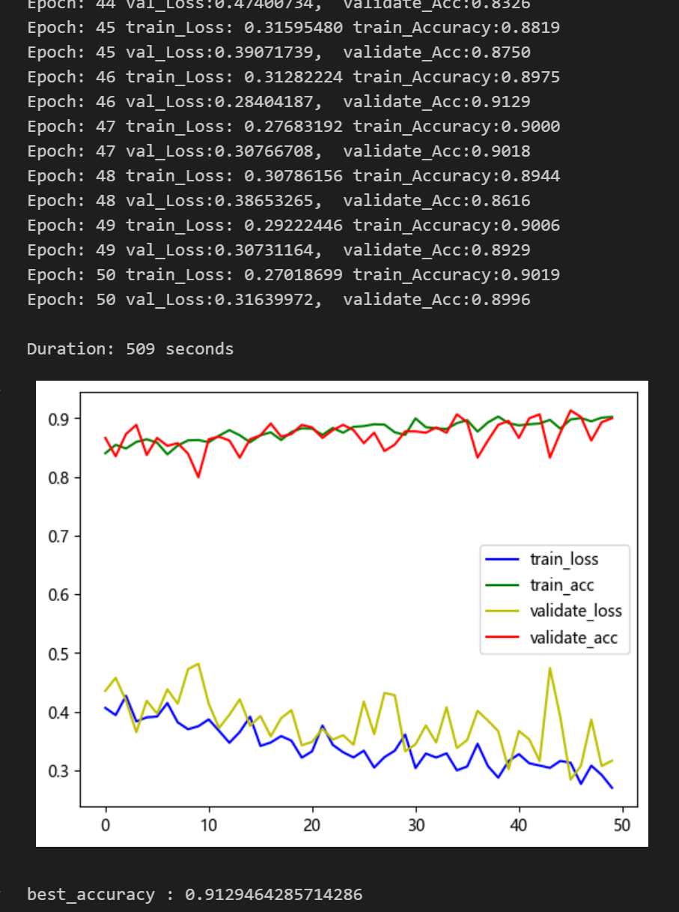

# Bearing Fault Diagnosis TCN-Attention Fault Classification Model

Including a complete bearing fault dataset, as well as the fault signal dataset, classification data, and label set that have been generated and ready for use.
Includes code for data preprocessing and TCN-Attention classification.
Environment: Python 3.9
\n        \n  
\n        \n  

## Images

<!-- PAYMENT_BLOCK -->

## Get this dataset

- Payment link (Stripe): [Buy now](https://buy.stripe.com/3cs8yP7sY87d0vu9AB)
- Payment QR code: 

<!-- /PAYMENT_BLOCK -->
